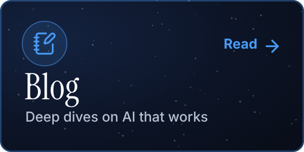
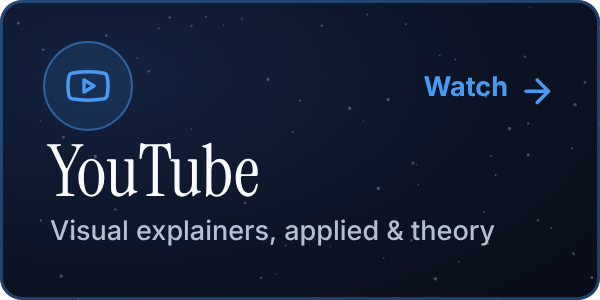
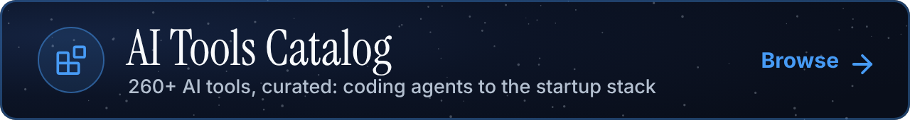

<!-- v4 · a7c3e1 · 2026-11-24 · aligned to brand guide (claim rules, voice, vocabulary) -->

<p align="center">
  
</p>

<p align="center">
  <a href="https://blog.andrewhopper.com"></a>
  <a href="https://www.youtube.com/@andrewhopperai"></a>
  <a href="https://blog.andrewhopper.com"></a>
</p>

<p align="center">
  <a href="https://andrewhopper.com/ai-tool-catalog"></a>
</p>

# Hi, I'm Andrew 👋

Sr. Solutions Architect, Startups at AWS, based in Boston. I've advised 500+ startups from pre-seed to IPO across aerospace, satellite, SaaS, consumer tech, and healthcare and life sciences.

Before AWS I was a 4x startup CTO: I co-founded Agentmaster, and three of the four companies were later acquired. I also led global marketing technology at PUMA.

Now I'm prototyping AI agent harnesses and teaching what works: 1,000+ GitHub contributions in 2026.

```
  signal ──▶ spec ──▶ agents ──▶ review ──▶ ship ──▶ users
             ▲                     │
             └──── shared context ◀┘     (protomcp)
```

## What I think about

| Idea | One line | Post |
|---|---|---|
| **Machine gunner → sniper** | Explore with many cheap shots while the blast radius is small; switch to precise, spec'd work when a miss gets expensive. | [100x your AI throughput](https://blog.andrewhopper.com/blog/a-simple-way-to-100x-your-ai-throughput) |
| **Beyond the chat box** | A transcript buries state. Agents and humans need a shared canvas they can both point at and edit. | [Optimizing human-AI interfaces](https://blog.andrewhopper.com/blog/optimizing-human-ai-interfaces) |
| **Batch → streaming** | Code is nearly free now. Specs, orchestration, review and CI are the new bottlenecks. | [Software development went exponential](https://blog.andrewhopper.com/blog/software-development-went-exponential) |

## What I'm building

**Software factory: agent harnesses**
- **protomcp**: shared, event-sourced knowledge graph and memory for every agent and device I use
- **Open Context Protocol**: portable spec for agent environments

**Cockpits: humans piloting agents**
- **AgentPrime**: agent cockpit
- **cview (ClawdView)**: live preview for agent-written HTML, React, SVG, Markdown
- **GoFlow**: flowchart editor agents edit over MCP
- **cspec**: keyboard-driven spec and mockup reviewer
- **QA Screenshot Annotator**: Chrome extension that turns annotated screenshots into tasks

## Stack

`TypeScript` · `Python` · `MCP` · `Claude Code` · `Amazon Bedrock` · `AWS CDK` · `Next.js` · `Postgres (Neon)`

## Find me

[Blog](https://blog.andrewhopper.com) · [YouTube](https://www.youtube.com/@andrewhopperai) · [AI Tool Catalog](https://andrewhopper.com/ai-tool-catalog) · [X](https://x.com/andrewhopper) · [LinkedIn](https://linkedin.com/in/andrewhopper)

DMs open. Views my own.

<!-- BLOG-POST-LIST:START -->
<!-- BLOG-POST-LIST:END -->
